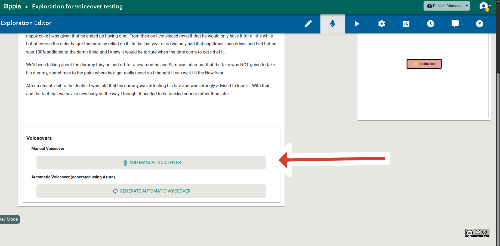
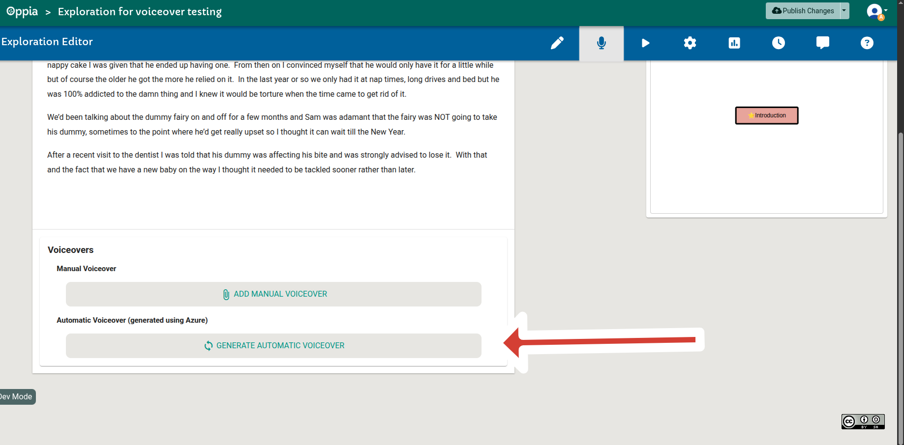
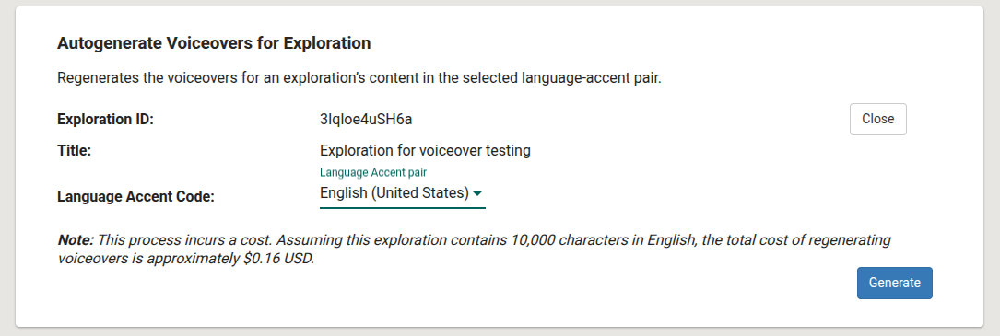

## Contents
- [Voiceovers in Oppia](#voiceovers-in-oppia)
- [How to Add Manual Voiceovers to Oppia Lessons](#how-to-add-manual-voiceovers-to-oppia-lessons)
- [How to Regenerate Automatic Voiceovers](#how-to-regenerate-automatic-voiceovers)
- [Precedence Between Automatic and Manual Voiceovers](#precedence-between-automatic-and-manual-voiceovers)
- [Adding a New Language-Accent Pair to Oppia's Voiceover Support](#adding-a-new-language-accent-pair-to-oppias-voiceover-support)
- [Generating All Voiceovers for a Curated Exploration in a Specific Language Accent](#generating-all-voiceovers-for-a-curated-exploration-in-a-specific-language-accent)
- [Technical Cheat Sheet – Troubleshooting Voiceover Regeneration](#technical-cheat-sheet--troubleshooting-voiceover-regeneration)
- [Getting Help](#getting-help)


## Voiceovers in Oppia

Oppia's lessons include voiceovers to support auditory learning. We’ve introduced **accent-specific** voiceovers, enabling students to hear lessons in accents familiar to them (e.g., English - United States or English - Nigeria).


## How to Add Manual Voiceovers to Oppia Lessons

Follow these steps to add a manual voiceover:

1. Navigate to the **Translation** tab in the Exploration Editor. The exploration must be **curated** (i.e., linked to a published story)
2. Select the desired **language and accent**.
   > [!NOTE]  
   > For non-English languages, ensure that the translation for that language exists. You cannot add a voiceover unless the translation is available.
3. Upload your manual voiceover in the selected language-accent pair.
4. And then Save the draft changes.




## How to Regenerate Automatic Voiceovers

Automatic voiceover generation is currently in its early phase, and requires certain conditions to be met:

### Pre-requisites

- The exploration must be **curated** (i.e., linked to a published story).
- Ensure the feature flags `"automatic_voiceover_regeneration_from_exp"` and `"show_regenerated_voiceovers_to_learners"` are enabled in the **Release Coordinator** page. Contact the release team for confirmation **(Email: web-server-admins@oppia.org)**.
- Admins must enable voiceover regeneration functionality via the **Admin Misc** tab. Reach out to the admin to verify. **(Email: voiceover-tech-support@oppia.org)**
- The desired **language-accent pair** must be supported by Oppia. Confirm with the voiceover admins. **(Email: voiceovers-leads@oppia.org)**

### Steps

1. Go to the **Translation** tab in the Exploration Editor.
2. Select the **language and accent**.
3. Click **Regenerate Voiceovers** for the selected language-accent.



## Precedence Between Automatic and Manual Voiceovers

When both manual and automatic voiceovers exist for the same content:

- **Manual voiceovers take precedence**.
- If a manual voiceover is marked as **stale**, the system will use the automatic voiceover instead.
- If only one type of voiceover is present (manual or automatic), that one will be used.

## Adding a New Language-Accent Pair to Oppia's Voiceover Support

Oppia supports voiceovers for a predefined set of language-accent pairs. Enabling a new pair makes it available to creators for adding manual voiceovers or generating automatic voiceovers. It also allows learners to listen to lesson voiceovers in the newly supported language accent.

To add support for a new language-accent pair, follow the steps below:

### Pre-requisites

1. Update the fields `LANGUAGE_CODE_TO_MATH_SYMBOL_PRONUNCIATIONS` & `LANGUAGE_CODE_TO_SENTENCE_ENDING_PUNCTUATION_MARKS` in the file **[constants.ts](https://github.com/oppia/oppia/blob/develop/assets/constants.ts)** via a pull request.

    > [!NOTE]   
    > If you're adding a new **accent** to an already supported language (e.g., adding "English (India)" when "English (United States)" is already supported), you don't need to update the above mentioned fields.


### Steps

1. Visit the **Voiceover Admin Page** (`/voiceover-admin`).

2. Locate the card titled **“Update language/accent pairs that learners and voice artists can select.”**

3. Click **“+ Add new language accent support”**, then select the new language-accent.

4. (Optional) Enable Automatic Voiceover for a language accent: Set "**Supports Autogeneration**" to "Yes" **only if**:
    - The language-accent is supported by Azure Text-to-Speech service.
    - You are aware that this will incur costs.
    - If you are unable to enable the Supports Autogeneration field for a language-accent pair and the system displays a modal requesting entries for LANGUAGE_CODE_TO_MATH_SYMBOL_PRONUNCIATIONS and LANGUAGE_CODE_TO_SENTENCE_ENDING_PUNCTUATION_MARKS, use the prompt below to generate the required data for the new language. You can use any AI model to generate the entries. Once the data is ready, update the corresponding constants and raise a PR with the changes.
        <details>
        <summary>Copy-ready prompt template</summary>

        ```text

            Task
            I want to add {{new_language}} to both lists mentioned below
            Context
            Oppia autogenerates voiceovers for its lessons. While a voiceover plays, the learner sees the sentence being spoken highlighted.
            Code context
            To onboard a new language for voiceovers, we maintain two constants:
            LANGUAGE_CODE_TO_MATH_SYMBOL_PRONUNCIATIONS: maps math symbols (+, -, *, ×, ÷, =, !, ^, ^2, ^3) to their spoken form in each language, which improves voiceover quality.
            LANGUAGE_CODE_TO_SENTENCE_ENDING_PUNCTUATION_MARKS: lists the punctuation marks that mark sentence boundaries, which is how highlighting works during playback.
            Both currently support en, hi, pt, ar, and es. Entries should be reviewed by the translation team before being added.
            Current List:
            // Please consult the translation team before adding any entries here.
            // These words improve the quality of automatic voiceovers.
            "LANGUAGE_CODE_TO_MATH_SYMBOL_PRONUNCIATIONS": {
            "en": {
            "+": "plus",
            "-": "minus",
            "*": "times",
            "×": "times",
            "÷": "divided by",
            "=": "equals",
            "!": "factorial of",
            "^": "to the power of",
            "^2": "squared",
            "^3": "cubed"
            },
            "hi": {
            "+": "जोड़",
            "-": "घटा",
            "*": "गुणा",
            "×": "गुणा",
            "÷": "विभाजित",
            "=": "बराबर",
            "!": "फैक्टोरियल",
            "^": "की घात",
            "^2": "वर्ग",
            "^3": "घन"
            },
            "pt": {
            "+": "mais",
            "-": "menos",
            "*": "vezes",
            "×": "vezes",
            "÷": "dividido por",
            "=": "igual a",
            "!": "fatorial",
            "^": "a potência de",
            "^2": "ao quadrado",
            "^3": "ao cubo"
            },
            "ar": {
            "+": "زَائِدْ",
            "-": "نَاقِصْ",
            "*": "ضَرْبْ",
            "×": "ضَرْبْ",
            "÷": "قِسْمَةْ عَلَى",
            "=": "يُسَاوِي",
            "!": "عَامِلِي",
            "^": "لِلْقُوَّةِ",
            "^2": "تَرْبِيعْ",
            "^3": "تَكْعِيبْ"
            },
            "es": {
            "+": "más",
            "-": "menos",
            "*": "multiplicado por",
            "×": "multiplicado por",
            "÷": "dividido",
            "=": "igual",
            "!": "factorial",
            "^": "elevado a",
            "^2": "al cuadrado",
            "^3": "al cubo"
            }
            },
            // Please consult the translation team before adding any entries here.
            // These punctuation marks are used to identify sentence boundaries during
            // voiceover playback.
            "LANGUAGE_CODE_TO_SENTENCE_ENDING_PUNCTUATION_MARKS": {
            "ar": "؟!",
            "en": ".!?",
            "es": ".!?",
            "pt": ".!?",
            "hi": "।!?"
            }
            Instruction
            Please give me only the new entries to add to the codebase, so I can include them in a PR. Don’t repeat the existing entries.

        ```

        </details>


### Generating All Voiceovers for a Curated Exploration in a Specific Language Accent

Follow these steps to generate all voiceovers for a curated exploration in a selected language accent:

1. Navigate to the Voiceover Admin page.

2. Scroll down to the Autogenerate Voiceovers for Exploration card.

3. Enter the Exploration ID of the exploration for which you want to generate voiceovers.

4. Select the desired language-accent pair from the dropdown.

5. Click Generate to trigger voiceover generation for the selected exploration and language accent.




## Cheat Sheet: Troubleshooting Voiceover Regeneration

### Manual Errors
| **Error Type**         | **Steps to Fix** |
|------------------------|------------------|
| **Autogeneration button disabled:**  Autogenerated voiceovers are not supported for the selected language accent. Please reach out to the voiceover admin if you would like them to be supported.| Reach out to voiceover admins (voiceovers-leads@oppia.org), they will either add the language accents to Oppia's voiceovers support or give you the rationale why this language accent can't be added.|
| **Autogeneration button disabled:**  Voiceover autogeneration via cloud services is currently disabled. Please contact the admins for more information.| Contact admin (voiceover-tech-support@oppia.org), for enabling Cloud based text-to-speech service from Admin tab.|
|**Adding / regenerating voiceovers buttons are disabled:** There is no content available for voiceover in the selected language.| Add translations for the given content either from contributor dashboard or from translation tab of the exploration editor page itself.|

### Technical Errors

| **Error Type**         | **Steps to Fix** |
|------------------------|------------------|
| **AuthenticationFailure** | Indicates an authentication error. This occurs if the subscription key or authorization token is invalid, expired, or does not match the region.<br><br>- Visit the Azure portal and verify that the API keys are not expired.<br>- Ensure the API key and region match the values in cloud secrets and the `feconf` file. |
| **Forbidden** | Indicates that the free subscription used by the request has run out of quota.<br><br>- Upgrade the subscription from the free plan to a standard plan to increase the quota. |
| **RuntimeError** | Indicates an unexpected runtime error.<br><br>- Check the error message and search online for common solutions.<br>- If no specific action is needed, try regenerating the voiceovers after 10–15 minutes.<br>- Take appropriate actions based on the error message.<br>- If the error persists after retrying, contact Azure Support or raise a question with the Azure team. |
| **ServiceError** | Indicates an error returned by the Speech service.<br><br> - Check the error message and look for solutions online.<br>- Verify that the language-accent code used for speech synthesis is still supported by Azure TTS. (See reference [here](https://learn.microsoft.com/en-us/azure/ai-services/speech-service/language-support?tabs=stt)).<br>- If no action is needed, retry after 10–15 minutes.<br>- Take appropriate actions based on the error message.<br>- If the issue continues, contact Azure Support or raise a question with the Azure team. |
| **ServiceUnavailable** | Indicates that the Speech service is currently unavailable.<br><br>- Retry after 10–15 minutes. |


## Getting Help

If you encounter issues or need assistance with voiceovers, please contact:

📧 **voiceover-tech-support@oppia.org**
